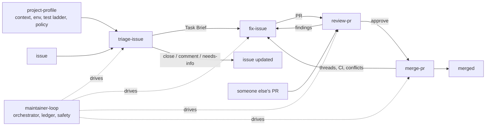

# maintainer-skills

Agent skills for maintaining a software project end to end: **triage an issue, fix it, test it as close
to production as the project allows, review pull requests, and merge them**. These skills are not
autocomplete helpers. They encode a maintainer's method: what to check, in which order, and what counts as
proof.

- **Generic.** The skills work on any repository and stack. Everything project-specific lives in one
  file, the **project profile**, which the `project-profile` skill drafts by inspecting the repo and
  running its commands.
- **Autonomous inside a sandbox, gated at the boundary.** Agents may build anything, run any suite, start
  real services, fuzz, bisect and run the software end to end, all in their own worktree and disposable
  environments. GitHub writes default to local drafts. Configure each action separately; shared
  machines, secrets, money, and irreversible actions outside that policy still need approval.
- **Evidence over claims.** A verdict needs an artifact: a test that fails before the fix and passes
  after, a log, a run ID, a merge commit on the base branch. Reading the code alone can justify a
  comment, never a close or a merge.
- **Multi-host.** Plain `SKILL.md` folders and Markdown role prompts. They work with Claude Code, Codex
  CLI, oh-my-pi (omp), and any agent that reads [Agent Skills](https://agentskills.io).



## Skills

| Skill | Use it to | Main output |
|---|---|---|
| [`project-profile`](skills/project-profile/SKILL.md) | Learn a repository: rules, toolchain, build, tests, e2e and live environments, CI, flakes, policy | Profile |
| [`triage-issue`](skills/triage-issue/SKILL.md) | Treat the issue as untrusted input, verify every cited SHA/version/PR, find duplicates and linked PRs, reproduce, bisect | Verdict + **Task Brief** |
| [`fix-issue`](skills/fix-issue/SKILL.md) | Set up an isolated environment, write the failing test first, make the smallest root-cause fix, climb the test ladder, open a PR | Branch, evidence, PR |
| [`review-pr`](skills/review-pr/SKILL.md) | Review any PR adversarially at an exact head, optionally verifying it by running it | Findings or approval |
| [`merge-pr`](skills/merge-pr/SKILL.md) | Close every review thread, triage CI, resolve conflicts, merge behind a hard gate | Merged PR |
| [`maintainer-loop`](skills/maintainer-loop/SKILL.md) | Run all of the above over many issues and PRs with subagents, a ledger and caps | Rounds, ledger, report |

Subagent roles in [`agents/`](agents/):

| Role | Job |
|---|---|
| `triager` | One issue to a verdict and a Task Brief |
| `fixer` | One Task Brief to a tested branch and a PR body |
| `refuter` | Try to break a verdict, plan, fix or review; it wins by finding a concrete counterexample |
| `pr-reviewer` | One PR at one head SHA, with findings backed by evidence |

## The test ladder

Every fix climbs as high as the project allows and reports the levels it could not reach:

| Level | What | Proves |
|---|---|---|
| L0 | Static: build, type check, lint, format | It compiles and follows the rules |
| L1 | Regression test that fails before the fix and passes after | The bug is caught |
| L2 | The affected test suites in full | Nothing nearby broke |
| L3 | Integration or e2e suite for the touched subsystem | Components still work together |
| L4 | Live run: the real binary or service in a realistic environment, used the way users use it | It works for real |
| L5 | Production-like soak or differential run against a reference | It keeps working and matches the reference |

The strongest L4 evidence is the same scenario run against the base and the fix. Recipes cover
libraries, CLIs, services, frontends, node software, data pipelines and infrastructure code:
[`test-ladder.md`](skills/fix-issue/references/test-ladder.md),
[`environment.md`](skills/fix-issue/references/environment.md).

## Install

Requirements: `bash` 4+, `git`, `gh` (authenticated), `jq`. Skills that run code also need the project's
own toolchain, which the profile describes.

```bash
git clone https://github.com/stdevMac/maintainer-skills ~/maintainer-skills
~/maintainer-skills/install.sh --dry-run    # show what would change
~/maintainer-skills/install.sh
```

| Host | Skills | Subagent roles |
|---|---|---|
| Codex CLI | `~/.agents/skills/<name>` | `~/.codex/agents/<role>.toml`, generated from `agents/<role>.md` |
| Claude Code | `~/.claude/skills/<name>` | `~/.claude/agents/<role>.md` |
| oh-my-pi (omp) | `~/.agents/skills/<name>` | `~/.omp/agent/agents/<role>.md` |
| Others | `~/.agents/skills/<name>` | Paste `agents/<role>.md` as the subagent prompt |

Skills and Markdown agents are symlinks, so `git pull` updates them. Re-run `install.sh` after pulling to
pick up new skills and to regenerate the Codex TOML. The script links each item separately and leaves
alone any existing file it did not create. `--uninstall` removes what it installed.
Use `install.sh --check` to detect missing links or stale Codex prompts without changing anything.

For one project only: `install.sh --project /path/to/repo` links the skills into that repo's
`.agents/skills/` and `.claude/skills/`.

## Quick start

```text
/project-profile owner/repo                 # once per repo; review the draft and keep it
/triage-issue 1234                          # one issue, ends with a verdict and a Task Brief
/fix-issue 1234                             # consumes the Task Brief
/review-pr 5678                             # any PR
/merge-pr 5678                              # check readiness and prepare next actions
/maintainer-loop --issues "label:bug" --batch 8    # everything, in rounds
```

Codex uses `$triage-issue 1234`. Hosts without skill commands: "use the triage-issue skill on issue 1234".

## Profiles

A profile tells the skills how this project builds, tests, runs live and ships, and what an agent may do
without asking. The template is
[`profile-template.md`](skills/project-profile/references/profile-template.md). The skills look for it in
this order:

1. `$MAINTAINER_PROFILE`
2. `<repo>/.agents/maintainer-profile.md`, then `<repo>/MAINTAINER_PROFILE.md` (shared with the team)
3. `${XDG_CONFIG_HOME:-~/.config}/maintainer-skills/profiles/<owner>__<repo>.md` (personal)

Personal profiles often name machines, private mirrors and accounts, so this repository never commits
them; see [`profiles/README.md`](profiles/README.md).

## Public actions are opt-in

Add an `## Actions` table to your personal profile or set `MAINTAINER_ACTIONS` for one session:

```bash
export MAINTAINER_ACTIONS='*=draft,pr_review=ask,pr_merge=off'
```

`draft` (default) saves a local payload without posting; `off` skips the action; `ask` requires
approval of the exact payload; `auto` still requires all evidence, readiness and resource gates.
Each action is independent: approving a review never authorizes merging. An explicit action in the
environment takes precedence over its wildcard, then the profile, then the default.
A profile checked into a project may describe its constraints, but it cannot grant publication
permission. Use the personal profile or an explicitly trusted profile selected with `$MAINTAINER_PROFILE`.
The merge and thread helpers also enforce policy when run directly. In `ask` mode, show the user the
exact preview first; pass its token with `--approve` only after they approve it. Tokens bind the PR,
head and requested operation, not the user's identity. They are not credentials and do not limit
what someone with GitHub credentials can do outside these helpers.

Check a stored facts file with `detect-project.sh /path/to/repo --check /path/to/repo.facts.md`.
Include `--gh` when the saved facts included GitHub data.

## State

| What | Location |
|---|---|
| Ledger, evidence, drafts, receipts | `${MAINTAINER_STATE:-${XDG_STATE_HOME:-~/.local/state}/maintainer-skills}/<owner>/<repo>/` |
| Worktrees | `$MAINTAINER_WORKTREES`, default `<state>/worktrees/` |

Nothing is kept only in chat memory: a new session resumes from the ledger.

## Scripts

Every script prints usage with `-h`, uses `set -euo pipefail`, and is read-only unless given an explicit
write flag.

| Script | Does |
|---|---|
| [`project-profile/scripts/detect-project.sh`](skills/project-profile/scripts/detect-project.sh) | Collects raw repo facts: toolchain pins, test projects, workflows, required checks |
| [`triage-issue/scripts/linked-prs.sh`](skills/triage-issue/scripts/linked-prs.sh) | PRs linked to an issue, by closing reference, text or cross-reference |
| [`fix-issue/scripts/worktree.sh`](skills/fix-issue/scripts/worktree.sh) | Owned worktrees with a registry; refuses to remove dirty or unpushed work |
| [`fix-issue/scripts/fail-before.sh`](skills/fix-issue/scripts/fail-before.sh) | Proves a regression test fails with the production change reverted, then restores the fix exactly |
| [`merge-pr/scripts/pr-state.sh`](skills/merge-pr/scripts/pr-state.sh) | One-shot readiness snapshot: head, approvals, threads, required checks |
| [`merge-pr/scripts/merge-when-green.sh`](skills/merge-pr/scripts/merge-when-green.sh) | Preview at an exact head; apply with `--merge` and any required approval. A moved head stops both preview and apply |
| [`merge-pr/scripts/reply-and-resolve.sh`](skills/merge-pr/scripts/reply-and-resolve.sh) | Preview and apply replies at an exact PR head; `--resolve` requests separately authorized resolutions |
| [`maintainer-loop/scripts/ledger.sh`](skills/maintainer-loop/scripts/ledger.sh) | Append-only JSONL ledger: skip lists, rounds, status |

## Layout

```text
skills/<name>/SKILL.md        entry point (frontmatter: name, description)
skills/<name>/references/     detail loaded on demand
skills/<name>/scripts/        helpers
agents/<role>.md              subagent role prompts
profiles/                     your profiles (git-ignored)
install.sh                    install into agent hosts
scripts/validate.sh           frontmatter, links, scripts, genericity, no tracked profiles
```

## Contributing

See [AGENTS.md](AGENTS.md). Run `scripts/validate.sh` before committing. Each new rule should cite the
failure that motivated it.

## License

[MIT](LICENSE)
